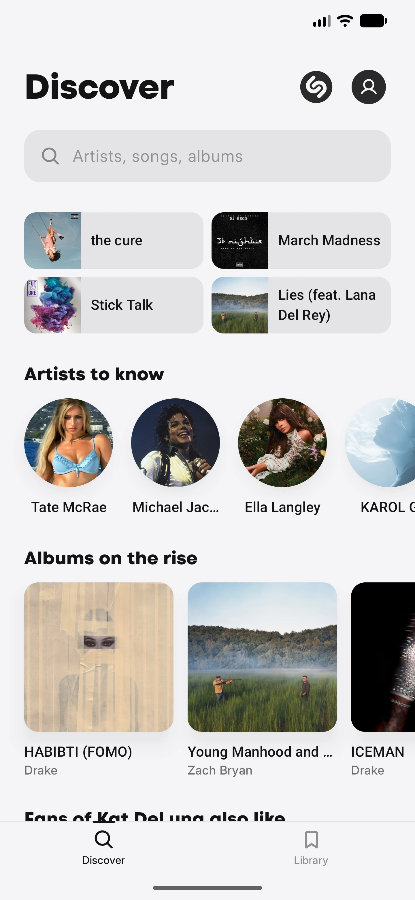
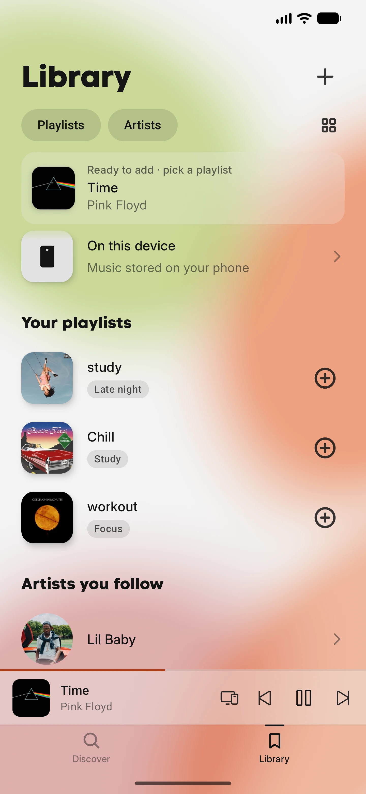
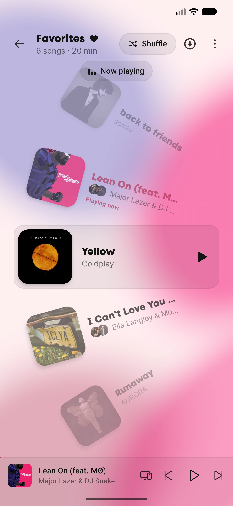
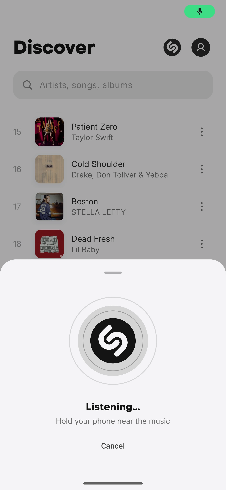
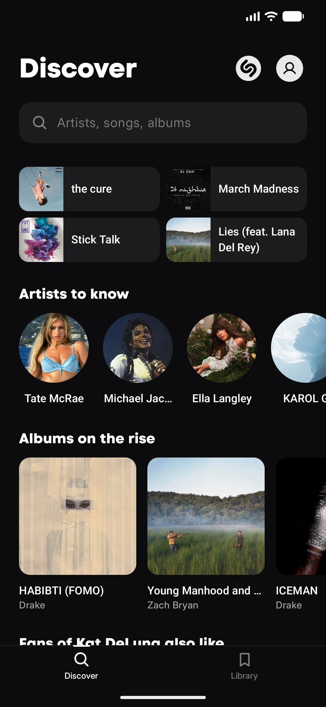
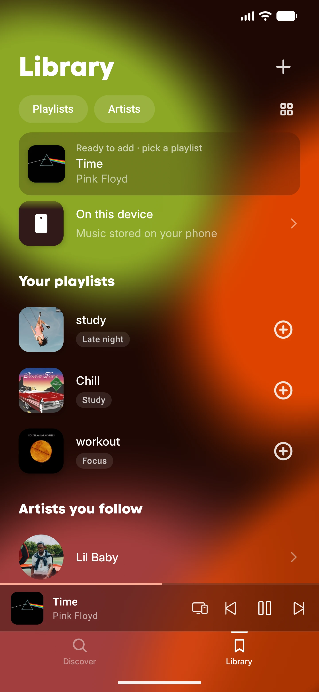
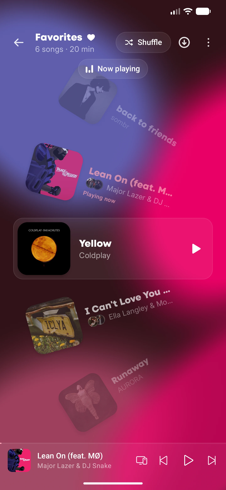
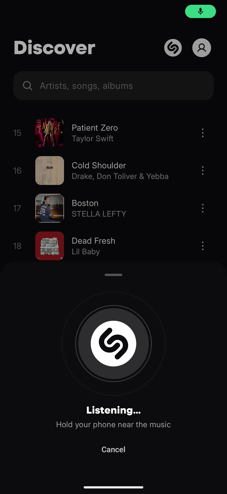
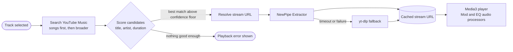

<div align="center">

<a href="https://serptail.github.io/gamut/">
  <picture>
    <source media="(prefers-color-scheme: dark)" srcset="gamut-brandkit/svg/gamut-horizontal-color-lighttext.svg">
    
  </picture>
</a>

<br><br>

**Free, open source music streaming for Android.**<br>
Stream any song, build your library, take it offline.

<br>

[](https://github.com/serptail/gamut/releases/latest)
[](https://github.com/serptail/gamut/actions/workflows/ci.yml)


[](LICENSE)

[**Download**](https://github.com/serptail/gamut/releases/latest) &nbsp;·&nbsp;
[Website](https://serptail.github.io/gamut/) &nbsp;·&nbsp;
[Features](#features) &nbsp;·&nbsp;
[Build from source](#building-from-source) &nbsp;·&nbsp;
[Report a bug](https://github.com/serptail/gamut/issues/new) &nbsp;·&nbsp;
[Support](#support)

<br>

<p>
  <picture>
    <source media="(prefers-color-scheme: dark)" srcset="docs/screens/discover-dark.webp">
    
  </picture>
  <picture>
    <source media="(prefers-color-scheme: dark)" srcset="docs/screens/library-dark.webp">
    
  </picture>
  <picture>
    <source media="(prefers-color-scheme: dark)" srcset="docs/screens/favorites-dark.webp">
    
  </picture>
  <picture>
    <source media="(prefers-color-scheme: dark)" srcset="docs/screens/shazam-dark.webp">
    
  </picture>
</p>

</div>

## Table of Contents

- [Overview](#overview)
- [Features](#features)
- [Screenshots](#screenshots)
- [Installation](#installation)
- [How It Works](#how-it-works)
- [Architecture](#architecture)
- [Tech Stack](#tech-stack)
- [Project Structure](#project-structure)
- [Building from Source](#building-from-source)
- [Permissions and Privacy](#permissions-and-privacy)
- [Troubleshooting](#troubleshooting)
- [FAQ](#faq)
- [Contributing](#contributing)
- [Support](#support)
- [Acknowledgements](#acknowledgements)
- [Disclaimer](#disclaimer)
- [License](#license)

## Overview

gamut is a complete music app for Android: search and play songs, build playlists, follow artists, download for offline listening, and keep everything in sync across devices. It has no subscription, no ads and no paywalled features, and it works without an account.

It is built entirely with Kotlin and Jetpack Compose, split into a modular Gradle project, with an optional Supabase backend that handles sync.

**Typical workflow:**

1. Open **Discover** and browse charts, or search for any artist, song or album.
2. Tap a result to start playback, then shape the sound with **Mods** and the **equalizer**.
3. Like songs, add them to **playlists** with mood tags, and follow artists.
4. Download what you want for **offline** playback.
5. Hear something out loud? Tap the **Shazam** button to identify it.

> **No account required.** Search, stream and build a library without signing up. Sign in with Google only if you want your favorites, playlists and followed artists to sync across devices.

## Features

| Area | What it does |
|---|---|
| **Discover** | Opens on albums on the rise, with Trending, Billboard, Latest and Albums charts. Search artists, songs and albums, with recent searches and quick-resume tiles |
| **Library** | Liked songs, playlists with mood tags, followed artists, offline downloads, plus the music already stored on your phone |
| **Player** | Colors drawn from the artwork, synced lyrics that follow the song line by line, queue, sleep timer, crossfade, and playback controls on the notification shade and lock screen |
| **Mods** | Nightcore, Daycore, Slowed + Reverb and Lo-Fi presets, or dial speed, pitch and bass yourself. Pitch can follow speed (tape style) or stay in key |
| **Equalizer** | 10-band parametric EQ from 60 Hz to 14 kHz, with presets, adjustable frequency and Q, and automatic headroom that lowers the level to match |
| **Song recognition** | Built-in Shazam button. Hold your phone near the music and gamut tells you what is playing |
| **Offline** | Download songs once and play them with no connection, individually or by playlist |
| **Sync** | Optional Google sign-in syncs favorites, playlists and followed artists to a new phone |
| **Sharing** | Send a song as a card image with its link, or just the URL, in the color you like |
| **Everywhere** | Android Auto browsing, notification and lock-screen controls, phones and tablets |
| **Appearance** | Light and dark themes throughout |

## Screenshots

<table>
  <tr>
    <th align="center">Discover</th>
    <th align="center">Library</th>
    <th align="center">Favorites</th>
    <th align="center">Song recognition</th>
  </tr>
  <tr>
    <td align="center"></td>
    <td align="center"></td>
    <td align="center"></td>
    <td align="center"></td>
  </tr>
  <tr>
    <td align="center"></td>
    <td align="center"></td>
    <td align="center"></td>
    <td align="center"></td>
  </tr>
</table>

<p align="center"><em>Every screen ships with matching dark and light themes. Library and Favorites pick up their background colors from the artwork that is playing.</em></p>

## Installation

gamut runs on **Android 8.0 (API 26) and newer**, on phones and tablets.

1. Open the [latest release](https://github.com/serptail/gamut/releases/latest) and download `.apk`.
2. Open the file on your phone. If Android asks, allow installs from your browser for this one time.
3. Launch gamut. No account or setup is needed.

> **Updates are built in.** gamut checks for new releases itself and downloads them in the background.

> **Note:** Official release builds target `arm64-v8a` and `armeabi-v7a`, which covers virtually all Android phones, 64-bit and 32-bit. Build from source if you need another ABI.

## How It Works

gamut does not host any music. When you play a track, it finds a matching source on YouTube Music and streams it, caching the result so repeat plays and the next song in the queue start quickly.



- **Matching.** Candidates are ranked by how well their title and channel match the track, with a bonus for official catalog and "Topic" uploads and penalties for stray words and derivative uploads. The track's duration is used as a sanity check.
- **Resolving.** NewPipe Extractor is tried first. If it times out or fails, gamut falls back to an embedded yt-dlp, which updates itself in the background.
- **Prefetching.** Upcoming tracks are resolved ahead of time on suitable connections, and resolved URLs are cached until they expire.
- **Metadata.** Artwork, artists and album details are enriched from public catalogs through a small Supabase edge function (`resolve-metadata`), with an allow-list on artwork hosts.
- **Staying alive.** Streaming sources change often. A scheduled workflow tests new NewPipe Extractor and yt-dlp releases every six hours and proposes version bumps, and the app can prompt you to update when a fix ships.

## Architecture

gamut is a multi-module Gradle project. Feature modules depend on core modules, never on each other, and `:app` wires everything together with Hilt.

| Module | Responsibility |
|---|---|
| `:app` | Entry points, navigation, profile and account screens, in-app updater, Shazam listening service |
| `:feature:feature-search` | Discover, search, artist and album screens, charts, song recognition |
| `:feature:feature-library` | Favorites, playlists and mood tags, downloads UI, on-device music |
| `:feature:feature-player-ui` | Player screen, lyrics, queue, equalizer, Mod sheet, sleep timer, sharing |
| `:feature:feature-resolver` | Track-to-stream resolution, candidate scoring, prefetching, download manager, yt-dlp updater |
| `:core:core-player` | Media3 player, media session service, Mod and sound-engine audio processors, equalizer, Android Auto browse tree |
| `:core:core-database` | Room database, DAOs, download index, recently played |
| `:core:core-network` | HTTP clients for search, catalogs and recognition |
| `:core:core-sync` | Supabase client, Google sign-in, sync of favorites, playlists and follows |
| `:core:core-model` / `core-common` | Shared models and utilities |
| `:core:core-designsystem` | Theme, typography, shared Compose components |
| `:baselineprofile` | Baseline and startup profile generation |
| `:tools:extractor-smoke` | Smoke test used to validate extractor upgrades |

## Tech Stack

**Android app**

| Concern | Choice |
|---|---|
| Language and UI | Kotlin 2.0, Jetpack Compose, Material 3 |
| Dependency injection | Hilt (with KSP) |
| Playback | AndroidX Media3, custom audio processors for Mods and EQ |
| Persistence | Room |
| Networking | Retrofit, OkHttp, Ktor, kotlinx.serialization |
| Streaming sources | NewPipe Extractor, youtubedl-android (yt-dlp) |
| Images and color | Coil, AndroidX Palette, Haze (blur) |
| Background work | WorkManager |
| Sync and auth | Supabase (Kotlin client), Credential Manager with Google ID |
| Performance | Baseline Profiles, Profile Installer |

**Backend** (optional, for sync): Supabase Postgres with row level security, and two Deno edge functions.

**Tooling:** Gradle Kotlin DSL with a version catalog, GitHub Actions for CI, releases, database backups and dependency bumps.

## Project Structure

```
.github/workflows/        ci, release, backup, keepalive, extractor-bump
app/                      Application module (entry points, update flow, accounts)
baselineprofile/          Baseline profile generator
core/
├── core-common/          Shared utilities
├── core-database/        Room entities, DAOs, download index
├── core-designsystem/    Theme and shared Compose UI
├── core-model/           Domain models
├── core-network/         API clients (search, catalogs, recognition)
├── core-player/          Media3 player, audio processors, equalizer, media session
└── core-sync/            Supabase client, auth, sync
feature/
├── feature-library/      Favorites, playlists, downloads, local music
├── feature-player-ui/    Player, lyrics, queue, EQ, Mods, sharing
├── feature-resolver/     Source resolution, scoring, downloads
└── feature-search/       Discover, search, artist and album pages
gamut-brandkit/           Logos and Android drawables
docs/                     Project website (GitHub Pages) and screenshots
scripts/                  bump_extractors.py
supabase/
├── functions/            resolve-metadata, delete-account
├── migrations/           SQL schema
└── tests/                Row level security tests
tools/extractor-smoke/    Extractor smoke test
```

## Building from Source

### Prerequisites

- JDK 21
- Android SDK with platform 35
- Android Studio (current stable) or the command line

### Build

```bash
git clone https://github.com/serptail/gamut.git
cd gamut
./gradlew :app:assembleDebug
```

The APK is written to `app/build/outputs/apk/debug/`.

Run the unit tests:

```bash
./gradlew testDebugUnitTest
```

### Optional: enable sync

Sync is **off by default** in a fresh checkout. Everything else works without it. To enable Google sign-in and sync, create a `local.properties` file in the project root:

```properties
SUPABASE_URL=https://your-project.supabase.co
SUPABASE_ANON_KEY=your-anon-key
GOOGLE_WEB_CLIENT_ID=your-google-web-client-id.apps.googleusercontent.com
```

When `SUPABASE_URL` or `SUPABASE_ANON_KEY` is blank, the sync layer disables itself. `local.properties` is git-ignored.

## Permissions and Privacy

| Permission | Why it is needed |
|---|---|
| `INTERNET` | Search, streaming, lyrics and catalog data |
| `RECORD_AUDIO` | Only while you run song recognition |
| `READ_MEDIA_AUDIO` | Playing music files already on your phone |
| Foreground services (media playback, data sync, microphone) | Background playback, downloads and recognition |

With sync, gamut stores only your favorite songs, playlists and the artists you follow, and nothing else. Read the full [privacy policy](https://serptail.github.io/gamut/privacy-policy/).

## Troubleshooting

| Symptom | Fix |
|---|---|
| "Songs can't be loaded right now" | The music source has probably changed. Check for an update inside the app or on the [releases page](https://github.com/serptail/gamut/releases/latest), and try again later |
| A track starts slowly or fails once | Retry. Stream URLs expire, and gamut refreshes and re-resolves them automatically |
| Android blocks the install | Allow installs from your browser (or file manager) for this one time in system settings |
| Song recognition does nothing | Grant the microphone permission and hold the phone closer to the audio source |
| Local files do not appear | Grant the audio permission, then open **Library → On this device** |
| No Google sign-in in a self-built app | Sync needs the `local.properties` keys described in [Optional: enable sync](#optional-enable-sync) |

Still stuck? [Open an issue](https://github.com/serptail/gamut/issues/new) with what happened and which phone you use.

## FAQ

<details>
<summary><strong>Is gamut really free?</strong></summary>

Yes. Streaming, downloads and every feature are free. gamut is open source under the GNU AGPLv3, so you can read the code, change it and share it, as long as your changes stay open under the same license.
</details>

<details>
<summary><strong>Do I need an account?</strong></summary>

No. Sign in with Google only if you want your favorites, playlists and followed artists to sync across devices.
</details>

<details>
<summary><strong>Where does the music come from?</strong></summary>

gamut searches and streams from YouTube Music, and also plays the files already on your phone, so everything lives in one library.
</details>

<details>
<summary><strong>Does it work offline?</strong></summary>

Yes. Songs you download in gamut play with no connection, and the files on your phone always play.
</details>

<details>
<summary><strong>Is there an iPhone or desktop version?</strong></summary>

No. gamut is Android only, with support for phones, tablets and Android Auto.
</details>

## Contributing

Bug reports, ideas and pull requests are all welcome.

1. [Open an issue](https://github.com/serptail/gamut/issues/new) first for anything non-trivial, so the approach can be agreed on.
2. Fork the repository and create a branch.
3. Follow the official Kotlin code style (`kotlin.code.style=official`) and the existing module boundaries.
4. Make sure the same checks CI runs pass locally:

   ```bash
   ./gradlew :app:assembleDebug testDebugUnitTest
   supabase test db   # if you touched supabase/
   ```

5. Open a pull request describing what changed and why.

When reporting a bug, include your Android version, device model and the steps that trigger it.

## Support

gamut is free and built in the open. If you enjoy it, any of these helps keep it that way:

- [Star the repository](https://github.com/serptail/gamut) so others can find it
- [Donate on Ko-fi](https://ko-fi.com/serptail)
- [Sponsor on GitHub](https://github.com/sponsors/serptail)
- Tell a friend

## Acknowledgements

gamut stands on the shoulders of excellent open source projects and public services:

- [NewPipe Extractor](https://github.com/TeamNewPipe/NewPipeExtractor) and [yt-dlp](https://github.com/yt-dlp/yt-dlp) (via [youtubedl-android](https://github.com/yausername/youtubedl-android)) for stream resolution
- [AndroidX Media3](https://developer.android.com/media/media3), [Jetpack Compose](https://developer.android.com/compose), [Room](https://developer.android.com/training/data-storage/room) and [Hilt](https://dagger.dev/hilt/)
- [Coil](https://coil-kt.github.io/coil/) and [Haze](https://github.com/chrisbanes/haze)
- [Phosphor Icons](https://phosphoricons.com) by Helena Zhang and Tobias Fried for the player and interface icons, through the [PhosphorIcon-compose](https://github.com/dev778g-me/PhosphorIcon-compose) Compose library by [@dev778g-me](https://github.com/dev778g-me)
- [Paper Shaders for Android](https://github.com/AndreFrelicot/paper-shaders-android) by [@AndreFrelicot](https://github.com/AndreFrelicot), a Jetpack Compose and AGSL port of the Paper Shaders effects by Paper Design, for the animated Mercury, Metaballs and Dithering backgrounds
- [Amplituda](https://github.com/lincollincol/Amplituda) by [@lincollincol](https://github.com/lincollincol) for audio waveform extraction
- [Supabase](https://supabase.com) for the optional sync backend
- [LRCLIB](https://lrclib.net) for synced lyrics
- [billboard-hot-100](https://github.com/mhollingshead/billboard-hot-100) by [@mhollingshead](https://github.com/mhollingshead) for the weekly Billboard Hot 100 chart data
- [MusicBrainz](https://musicbrainz.org), the [Cover Art Archive](https://coverartarchive.org), Deezer and iTunes for catalog metadata and artwork

## Disclaimer

gamut is an independent project and is not affiliated with, endorsed by or sponsored by YouTube, Google, Shazam, Apple, Deezer, Billboard or any other third party mentioned here. All trademarks and album artwork belong to their respective owners. gamut does not host or distribute any audio. You are responsible for using it in accordance with the terms of the services it connects to and the laws where you live.

## License

gamut is licensed under the **GNU Affero General Public License v3.0**. See [LICENSE](LICENSE) for the full text.

You are free to use, study, modify and share it, provided that derivative works, including those offered over a network, are released under the same license.

<br>

<div align="center">

Made with love by [@serptail](https://github.com/serptail)

<sub>The gamut name, wordmark and ribbon mark in <code>gamut-brandkit/</code> identify the project.</sub>

</div>
